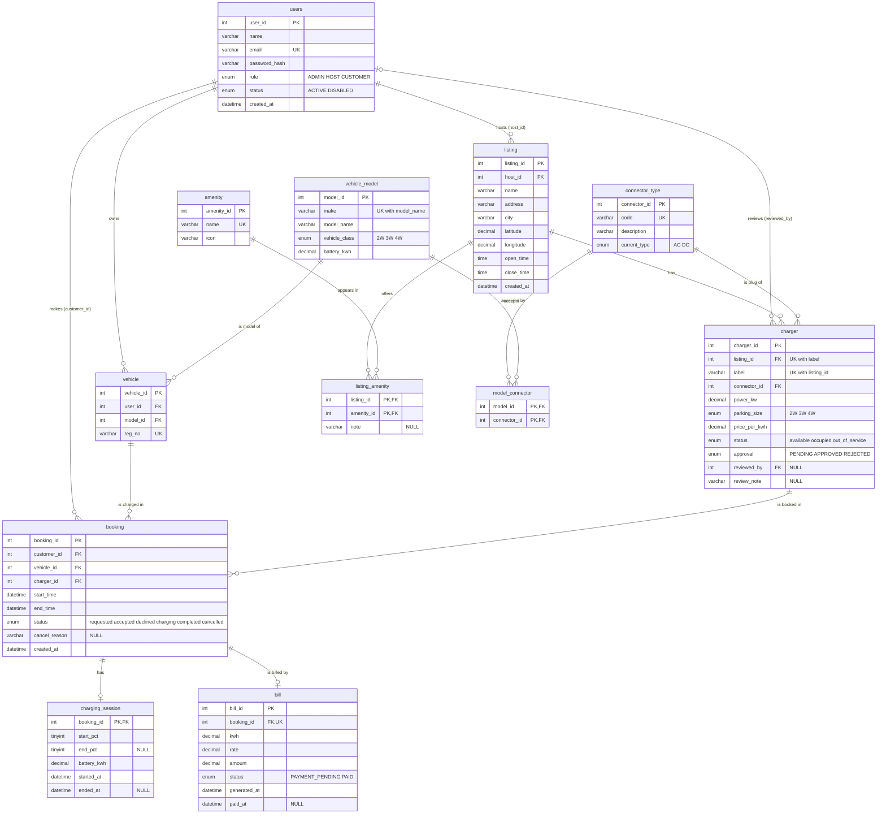

# ChargeMatch Lite — Database Report

Database **`chargematch_lite`** · MySQL 8+ · InnoDB · `utf8mb4`

| Object | Count | Names |
|---|---|---|
| Tables | 12 | users, connector_type, amenity, listing, listing_amenity, charger, vehicle_model, model_connector, vehicle, booking, charging_session, bill |
| Views | 2 | v_searchable_chargers, v_revenue_per_listing |
| Triggers | 5 | trg_booking_bi, trg_booking_bu, trg_booking_au, trg_session_au, trg_bill_bu |
| Functions | 1 | fn_compat_reason |
| Procedures | 2 | accept_booking, end_session |
| CHECK constraints | 18 | listed in §3 |

Rows after a fresh `./setup_db.sh` (seed.sql). A database in use has more users, listings, vehicles and bookings.

| Table | Rows | | Table | Rows |
|---|---|---|---|---|
| users | 11 (1 admin, 5 hosts, 5 customers) | | vehicle_model | **56** (15 2W, 7 3W, 34 4W: the original ChargeMatch catalogue) |
| connector_type | 8 | | model_connector | 110 |
| amenity | 16 | | vehicle | 8 |
| listing | 10 | | booking | 30 |
| listing_amenity | 22 | | charging_session | 17 |
| charger | 20 | | bill | 16 |

---

## 1. The idea in one paragraph

A **host** registers a *listing* (their home or garage, pinned on a map, with opening hours and amenities) and adds
one or more *chargers*, each with a plug type, power and price per kWh. An **admin** must approve a charger before
customers can find it. A **customer** registers *vehicles* (a model from the catalogue plus a number plate). They search
for chargers whose plug fits their vehicle and *book* a time slot. The host accepts or declines the request. When the car
arrives the host starts a *charging session* with the battery %. When it leaves, the host ends the session with the new
battery %. The database then generates the *bill* by itself: (end% − start%) / 100 × battery kWh × rate. The host marks
the bill paid, and the customer can then *rate* the listing.

## 2. ER diagram

`||` = exactly one, `o|` = zero or one, `o{` = zero or many. PK = primary key, FK = foreign key, UK = unique.



**How to read the main relationships**
* **users → listing / vehicle / booking: 1 : N.** One `users` table serves all three roles, told apart by `role`.
* **listing ↔ amenity: M : N**, resolved by the bridge table `listing_amenity` (which also holds a `note`).
* **vehicle_model ↔ connector_type: M : N**, resolved by `model_connector`. A Tata Nexon EV LR accepts TYPE2, CCS2 and the 15A socket.
* **booking → charging_session, bill: 1 : 0..1.** `charging_session` uses `booking_id` as its own PK.
  `bill` has a UNIQUE `booking_id`. This is how a 1:1 relationship is enforced.

---

## 3. Tables, keys and constraints

Notation: **PK** primary key · **FK** foreign key (with ON DELETE action) · **UQ** unique · **CHK** check.

### Admin-managed master data

**`users`**: everyone who logs in.
* PK `user_id` · UQ `email` (no phone number is stored)
* CHK `chk_users_email`: `email LIKE '%_@_%._%'`
* Passwords are stored only as Werkzeug **scrypt hashes**.
* Users are never deleted, because their bookings and bills are history. `status = 'DISABLED'` (set in SQL; the app
  has no disable button) blocks the login and hides a host's chargers from search.

**`connector_type`**: lookup of plug standards (TYPE2, IND_SOCKET, CCS2, LECCS, BHARAT_AC001, TYPE1, CHADEMO, BHARAT_DC001).
  Chargers may only use the four AC home plugs (`chk_charger_setup`); the DC codes exist because vehicle models accept them.
* PK `connector_id` · UQ `code` · `current_type` ENUM AC/DC

**`amenity`**: lookup of facilities (Covered parking, Restroom, Wi-Fi, ...).
* PK `amenity_id` · UQ `name`

### Host side

**`listing`**: a host's location.
* PK `listing_id` · FK `host_id → users` **ON DELETE RESTRICT** (a host with listings can't be deleted)
* CHK `chk_listing_lat` (−90..90) · CHK `chk_listing_lng` (−180..180) · CHK `chk_listing_hours` (`open_time < close_time`)
* INDEX `city`, used by city search.

**`listing_amenity`**: M:N bridge.
* PK (`listing_id`, `amenity_id`) · FK `listing_id` **CASCADE** · FK `amenity_id` **CASCADE**. A bridge row has no meaning without both sides.

**`charger`**: one physical charging point.
* PK `charger_id` · UQ (`listing_id`, `label`) so "Bay A" is unique *within* a listing
* FK `listing_id → listing` **CASCADE** (in practice blocked once the charger has bookings, because booking → charger is RESTRICT)
* FK `connector_id → connector_type` **RESTRICT** · FK `reviewed_by → users` **SET NULL** (keep the charger if the reviewing admin is removed)
* CHK `chk_charger_price` (₹5–30 per kWh)
* CHK `chk_charger_label`: `CHAR_LENGTH(TRIM(label)) >= 3`. The host always types the label (the app never makes one up)
* CHK **`chk_charger_setup`**: the home-charger rules in one constraint. AC plugs only, each with a short list of
  power values, and LECCS only on a 2W / 3W bay:
  `(connector_id = 1 AND power_kw IN (3.3, 7.4, 11, 22))` Type 2 (11 / 22 kW are 3-phase) ·
  `OR (connector_id = 2 AND power_kw IN (2.2, 3.3))` 15A socket · `OR (connector_id = 5 AND power_kw = 3.3)` Bharat AC-001 ·
  `OR (connector_id = 4 AND power_kw IN (1.5, 3.0) AND parking_size IN ('2W','3W'))` LECCS.
  A CHECK can't look up another table, so it uses the fixed connector ids from `seed.sql`; the integrity check
  repeats the rule by connector *code* to prove the ids still match. CCS2, Type 1, CHAdeMO and Bharat DC-001 match no
  branch, so a DC or imported plug can never be stored.
* `parking_size` (2W / 3W / 4W) is the largest vehicle the bay fits; `fn_compat_reason` compares it with the vehicle.
  Phase isn't stored: it follows from the power (a home supply above 7.4 kW is 3-phase), so a column would only repeat it.
* `status` is physical (available / occupied / out_of_service). `approval` is the admin workflow (PENDING/APPROVED/REJECTED).
* **Out of service** (the host's toggle on My chargers, one Flask transaction): sets `out_of_service` and cancels the
  charger's `requested` / `accepted` bookings with the reason "Charger taken out of service by the host". The charger
  leaves `v_searchable_chargers` (search + map), `trg_booking_bi` refuses new bookings and `accept_booking` refuses
  to accept. A session already charging continues; when it ends `trg_booking_au` leaves `out_of_service` alone.
* **Delete**: `DELETE FROM charger` succeeds only for a charger with no bookings at all. Otherwise the booking FK
  (ON DELETE RESTRICT) refuses it (MySQL error 1451) and the app says to set it Out of service instead.

### Customer side

**`vehicle_model`**: catalogue.
* PK `model_id` · UQ (`make`, `model_name`) · CHK `chk_model_battery` (`battery_kwh > 0`)

**`model_connector`**: M:N bridge (which plugs a model accepts).
* PK (`model_id`, `connector_id`) · both FKs **CASCADE**

**`vehicle`**: a customer's actual car or scooter.
* PK `vehicle_id` · UQ `reg_no` · FK `user_id` **RESTRICT** · FK `model_id` **RESTRICT**
* CHK `chk_vehicle_reg`: `REGEXP_LIKE(reg_no, '^[A-Z]{2}[0-9]{2}[A-Z]{1,3}[0-9]{4}$', 'c')`, e.g. **KA19MN1234**

**`booking`**: a requested time slot.
* PK `booking_id` · FKs `customer_id`, `vehicle_id`, `charger_id` all **RESTRICT** (history must stay)
* CHK `chk_booking_order` (`end_time > start_time`) · CHK `chk_booking_duration` (15 min – 12 h, via `TIMESTAMPDIFF`)
* INDEX (`charger_id`, `status`, `start_time`, `end_time`) makes the overlap test fast.

**`charging_session`**: 1:1 with booking. What actually happened.
* PK = FK `booking_id → booking` **CASCADE**
* CHK `chk_session_start` (0–100) · CHK `chk_session_end` (`end_pct > start_pct AND ≤ 100`)
* CHK `chk_session_ended` (`end_pct` and `ended_at` are both NULL or both set) · CHK `chk_session_battery` (> 0)

**`bill`**: created by a trigger, never typed in.
* PK `bill_id` · UQ + FK `booking_id` **RESTRICT** (money records are never deleted)
* CHK `chk_bill_values` (`kwh ≥ 0, amount ≥ 0, rate > 0`)
* CHK `chk_bill_paid` (`(status = 'PAID') = (paid_at IS NOT NULL)`), so `paid_at` is set **exactly** when the bill is PAID
* CHK `chk_bill_paid_after` (`paid_at ≥ generated_at`)

**CHECK total: 18** (users 1, listing 3, charger 3, vehicle_model 1, vehicle 1, booking 2, charging_session 4, bill 3).
**Foreign keys: 15.**

---

## 4. Normalisation

**1NF.** Every column holds one atomic value. There are no repeating groups. A listing's amenities and a model's
plugs, which are multi-valued facts, live in the bridge tables `listing_amenity` and `model_connector`. They are not
stored as a comma list such as `"TYPE2,CCS2"` in one column.

**2NF.** The only composite keys are in the two bridge tables. `listing_amenity.note` depends on the *whole* key
(the note is about *this* amenity at *this* listing). `model_connector` has no non-key columns. Every other table has
a single-column key, so partial dependency is impossible.

**3NF / BCNF.** No non-key column depends on another non-key column. Plug details are stored once in
`connector_type`, not repeated on every charger. Battery size is stored once in `vehicle_model`, not on every
vehicle. Host details live in `users`, not in `listing`.

| Table | Normal form | Note |
|---|---|---|
| users | BCNF | candidate keys user_id and email only; all attributes depend only on them |
| connector_type | BCNF | code is a candidate key |
| amenity | BCNF | name is a candidate key |
| listing | BCNF | host details live in users |
| listing_amenity | BCNF | composite key, note depends on the whole key |
| charger | BCNF | candidate keys charger_id and (listing_id, label); plug details in connector_type |
| vehicle_model | BCNF | candidate keys model_id and (make, model_name) |
| model_connector | BCNF | all-key table |
| vehicle | BCNF | candidate keys vehicle_id and reg_no |
| booking | 3NF* | see `customer_id` below |
| charging_session | BCNF* | `battery_kwh` is a snapshot, see below |
| bill | 3NF* | `rate` snapshot and stored `amount`, see below |

\* **Deliberate, controlled redundancy.** Each case is explained for the viva:

| Column | Could be derived from | Why it is stored anyway | What keeps it correct |
|---|---|---|---|
| `booking.customer_id` | `vehicle.user_id` | who *made* the booking is a fact about the booking; it also makes "my bookings" a simple indexed lookup | `trg_booking_bi` refuses a vehicle that doesn't belong to the customer; slot details are frozen by `trg_booking_bu` |
| `charging_session.battery_kwh` | `vehicle_model.battery_kwh` | **historical snapshot**: if the catalogue is corrected later, old bills must not change | copied when the host starts the session (`start_session()` in Flask); checked by `check_integrity.py` |
| `bill.rate` | `charger.price_per_kwh` | **historical snapshot**: the host may change the price tomorrow | copied by `trg_session_au`; frozen by `trg_bill_bu` |
| `bill.kwh`, `bill.amount` | session % and rate | a bill is a legal money record and must never be recomputed | computed once by `trg_session_au`; frozen by `trg_bill_bu`; verified by `check_integrity.py` |

---

## 5. Stored programs: what and why

### Function (1)

| Function | Returns | Why |
|---|---|---|
| `fn_compat_reason(charger_id, vehicle_id)` | `NULL` if the vehicle can use the charger, else a sentence. Two rules: the vehicle's model accepts the charger's plug (*"Plug mismatch: your Ola S1 Pro takes IND_SOCKET but this charger has TYPE2."*), and the vehicle fits the parking bay, 2W < 3W < 4W (*"Parking bay is for 2W, your Nissan Leaf (imported) is 4W."*) | One definition of "compatible", used in **three** places: customer search (`WHERE fn_compat_reason(...) IS NULL`), the booking trigger (it signals the same sentence), and the integrity check. |

The charger's one-word status (pending / rejected / out of service / in use / available) is a plain `CASE` on
`approval` and `status`, in `v_searchable_chargers` and in Flask (`CHARGER_STATUS_SQL`). "In use" is simply
`status = 'occupied'`, which `trg_booking_au` keeps in step with charging sessions.

### Triggers (5)

| Trigger | Fires | What it enforces | Why a trigger |
|---|---|---|---|
| `trg_booking_bi` | BEFORE INSERT booking | **validate + overlap**: status must be `requested`; start in the future; the vehicle belongs to the customer; the charger is APPROVED and not `out_of_service`; the slot is inside opening hours on one day; the plug and bay fit (`fn_compat_reason`); **no overlap** with accepted/charging bookings on that charger (`start1 < end2 AND end1 > start2`) | The rules hold for *every* client (app, CLI, seed), not just the web form. `SIGNAL SQLSTATE '45000'` sends a readable message, which the app shows as-is. |
| `trg_booking_bu` | BEFORE UPDATE booking | **status rules**: requested→accepted/declined/cancelled, accepted→charging/cancelled, charging→completed. Charging needs an open session and completed needs a finished one. Slot/vehicle/charger can't be edited after creation. **Late requests**: requested→accepted is allowed after the start time, but not once the slot's `end_time` has passed (then only decline). Fills a default `cancel_reason`. | Illegal jumps such as `completed → requested` are impossible even with a hand-written UPDATE. |
| `trg_booking_au` | AFTER UPDATE booking | **charger occupied / available**: entering `charging` sets the charger `occupied`; leaving it sets it back to `available` (never overwrites `out_of_service`) | Charger status can't drift out of sync with sessions. |
| `trg_session_au` | AFTER UPDATE charging_session | **bill on session end**: when `end_pct` is set, `kwh = ROUND((end−start)/100 × battery_kwh, 2)`, `rate = charger price`, `amount = ROUND(kwh × rate, 2)`; **INSERT bill**; booking → `completed`. A finished session can't be edited. | Billing happens automatically and the same way every time. Nobody types an amount. |
| `trg_bill_bu` | BEFORE UPDATE bill | **bill read-only**: kwh/rate/amount/booking can never change; a PAID bill is locked; sets `paid_at = NOW()` when it becomes PAID | Financial integrity. Together with `chk_bill_paid`, `paid_at` exists exactly when the bill is PAID. |

Trigger chain when a host ends a session:
`CALL end_session` → UPDATE charging_session → **trg_session_au** → INSERT bill + UPDATE booking →
**trg_booking_bu** (checks charging→completed) → **trg_booking_au** (charger → available).

### Procedures (2)

Both follow the same pattern:

```sql
DECLARE EXIT HANDLER FOR SQLEXCEPTION BEGIN ROLLBACK; RESIGNAL; END;
START TRANSACTION;
  -- 1. look up the booking and its charger's host
  -- 2. SIGNAL if the caller (p_host_id) is not that host
  -- 3. validate state, then do the work
COMMIT;
```
`RESIGNAL` re-raises the original error after the rollback, so the app still receives the exact message.

| Procedure | What it does | Why a procedure |
|---|---|---|
| `accept_booking(host_id, booking_id)` | `SELECT … FROM charger … FOR UPDATE` locks the charger row, checks the booking is still `requested`, its slot has not ended yet (a late start is fine), the charger is in service and nothing accepted overlaps it, sets it `accepted`, then **declines every other overlapping request** with the reason "Slot given to another booking". | Two hosts' browsers (or two tabs) accepting overlapping requests at the same moment are **serialised** by the row lock, so double-booking is impossible. Several statements must succeed or fail together. |
| `end_session(host_id, booking_id, end_pct)` | checks the booking is charging and `end_pct > start_pct`; sets `end_pct`, `ended_at`. The trigger chain then bills and completes it. | one call does the whole finish |

**Plain SQL in Flask instead of procedures** (parameterised, the host check done in Python):
* *Start session* (`start_session()` in `app.py`): one transaction. It reads the booking with its host, refuses if
  the logged-in host isn't that host, then locks the charger row (`SELECT … FOR UPDATE`). It checks the booking is
  accepted, start % 0–99, now is from 30 minutes before the slot until its end, and the charger isn't
  out of service or occupied. It then inserts `charging_session` (battery snapshot) and sets the booking to `charging`.
* *Mark bill paid*: one `UPDATE bill … JOIN booking JOIN charger JOIN listing SET status = 'PAID' WHERE bill_id = ?
  AND host_id = ? AND status = 'PAYMENT_PENDING'`. The WHERE clause is the ownership check, and `trg_bill_bu` stamps
  `paid_at`.

### Views (2)

| View | Definition (short) | Used by |
|---|---|---|
| `v_searchable_chargers` | charger ⋈ connector_type ⋈ listing ⋈ users, `WHERE approval = 'APPROVED' AND status <> 'out_of_service' AND host is ACTIVE`, plus a `CASE` on status as `live_status` | customer search map and listing page. Hides PENDING/REJECTED and out-of-service chargers and disabled hosts in one place. |
| `v_revenue_per_listing` | listing ⋈ users **LEFT JOIN** charger **LEFT JOIN** booking **LEFT JOIN** bill (`AND bl.status = 'PAID'` in the **ON** clause) | host **My chargers** page: the “Earned ₹… · kWh sold …” line on each listing (joined to the host's listings). The PAID filter is in `ON`, not `WHERE`; in WHERE it would turn the LEFT JOIN into an inner join and drop listings with ₹0. |

---

## 6. Transactions, concurrency and security

* **ACID.** All tables are InnoDB. Multi-step changes run inside one transaction: the four procedures, and saving a
  listing together with its amenities (`conn.begin()` … `commit()` / `rollback()` in `app.py`).
* **Locking.** `accept_booking` uses `SELECT … FOR UPDATE` on the charger row. A second concurrent accept for the same
  charger waits, then sees the first one's result and refuses the overlap.
* **Least privilege.** The app connects as `cmlite_app` with `SELECT, INSERT, UPDATE, DELETE, EXECUTE` on
  `chargematch_lite.*` only. It cannot DROP, ALTER or read other databases (tested). Triggers, procedures and views
  run with their definer's rights.
* **SQL injection.** Every query in `app.py` uses `%s` placeholders (PyMySQL parameter binding). User input is never
  concatenated into SQL.
* **Passwords** are scrypt hashes. Forms carry a CSRF token.
* **Seed bypass.** `seed.sql` needs *past* bookings. It sets `@cm_seed_bypass = 1`, which `trg_booking_bi` honours
  **only for the MySQL user root** and **only for the two clock rules** (start in the future, opening hours). Every other
  rule still runs. All history follows the real state machine:
  `INSERT (requested) → accepted → session → charging → end_pct` (the trigger bills it) `→ PAID`.

---

## 7. Sample queries (run with `mysql -u root chargematch_lite`)

**Q1. Upcoming and active bookings with customer, vehicle and place (5-table INNER JOIN)**
```sql
SELECT b.booking_id, u.name AS customer, CONCAT(m.make, ' ', m.model_name) AS vehicle,
       l.name AS listing, c.label, b.start_time, b.status
  FROM booking b
  JOIN users u         ON u.user_id    = b.customer_id
  JOIN vehicle v       ON v.vehicle_id = b.vehicle_id
  JOIN vehicle_model m ON m.model_id   = v.model_id
  JOIN charger c       ON c.charger_id = b.charger_id
  JOIN listing l       ON l.listing_id = c.listing_id
 WHERE b.status IN ('requested', 'accepted', 'charging')
 ORDER BY b.start_time;
```

**Q2. Approved chargers that fit the Ather KA19EX4521 (subquery with IN)**
```sql
SELECT c.charger_id, l.name, c.label, ct.code, c.price_per_kwh
  FROM charger c
  JOIN connector_type ct ON ct.connector_id = c.connector_id
  JOIN listing l         ON l.listing_id    = c.listing_id
 WHERE c.approval = 'APPROVED'
   AND c.connector_id IN (SELECT mc.connector_id
                            FROM vehicle v JOIN model_connector mc ON mc.model_id = v.model_id
                           WHERE v.reg_no = 'KA19EX4521');
```

**Q3. Listings and chargers per host (LEFT JOIN + COUNT DISTINCT)**
```sql
SELECT u.name AS host, COUNT(DISTINCT l.listing_id) AS listings, COUNT(c.charger_id) AS chargers
  FROM users u
  LEFT JOIN listing l ON l.host_id    = u.user_id
  LEFT JOIN charger c ON c.listing_id = l.listing_id
 WHERE u.role = 'HOST'
 GROUP BY u.user_id, u.name;
```

**Q4. Customers who spent more than ₹300 (GROUP BY + HAVING)**
```sql
SELECT u.name, COUNT(b.booking_id) AS completed, SUM(bl.kwh) AS kwh, SUM(bl.amount) AS spent
  FROM users u
  JOIN booking b ON b.customer_id = u.user_id AND b.status = 'completed'
  JOIN bill bl   ON bl.booking_id = b.booking_id
 GROUP BY u.user_id, u.name
HAVING SUM(bl.amount) > 300
 ORDER BY spent DESC;
```

**Q5. Listings that have not earned anything yet (query on a view)**
```sql
SELECT listing_name, city, host_name, chargers
  FROM v_revenue_per_listing
 WHERE revenue = 0;
```

**Q6. Requests that clash with another request on the same charger (SELF JOIN)**
```sql
SELECT a.booking_id, b.booking_id AS clashes_with, a.charger_id, a.start_time, a.end_time
  FROM booking a
  JOIN booking b ON b.charger_id = a.charger_id AND b.booking_id > a.booking_id
                AND a.start_time < b.end_time AND a.end_time > b.start_time
 WHERE a.status = 'requested' AND b.status = 'requested';
```

**Q7. Popularity of each amenity, including unused ones (LEFT JOIN on the M:N bridge)**
```sql
SELECT a.icon, a.name, COUNT(la.listing_id) AS listings
  FROM amenity a
  LEFT JOIN listing_amenity la ON la.amenity_id = a.amenity_id
 GROUP BY a.amenity_id, a.icon, a.name
 ORDER BY listings DESC;
```

**Q8. Which vehicles can use the Bejai 22 kW wallbox (#5), and why not (stored function in SELECT)**
```sql
SELECT v.reg_no, CONCAT(m.make, ' ', m.model_name) AS model,
       IFNULL(fn_compat_reason(5, v.vehicle_id), 'compatible') AS verdict
  FROM vehicle v JOIN vehicle_model m ON m.model_id = v.model_id;
```

**Q9. Three listings closest to Kankanady, Mangaluru (spatial function)**
```sql
SELECT name, city,
       ROUND(ST_Distance_Sphere(POINT(longitude, latitude), POINT(74.8560, 12.8698)) / 1000, 1) AS km
  FROM listing
 ORDER BY km
 LIMIT 3;
```

**Q10. Bill reconciliation: recompute every bill from its session (JOIN + derived columns)**
```sql
SELECT bl.bill_id, s.start_pct, s.end_pct, s.battery_kwh,
       bl.kwh,    ROUND((s.end_pct - s.start_pct) / 100 * s.battery_kwh, 2) AS kwh_check,
       bl.amount, ROUND(bl.kwh * bl.rate, 2)                               AS amount_check,
       bl.status, bl.paid_at
  FROM bill bl
  JOIN charging_session s ON s.booking_id = bl.booking_id
 ORDER BY bl.bill_id;
```

**Bonus: the views, the function and a procedure**
```sql
SELECT * FROM v_searchable_chargers WHERE city = 'Udupi';
SELECT fn_compat_reason(15, 8);                      -- Leaf at the 2W 'Garden' socket: parking bay too small
SELECT * FROM v_revenue_per_listing ORDER BY revenue DESC;
SELECT charger_id, label, live_status FROM v_searchable_chargers;
CALL accept_booking(2, 22);   -- host 2 accepts #22; overlapping #29 is auto-declined
SELECT booking_id, status, cancel_reason FROM booking WHERE booking_id IN (22, 29);
```

---

## 8. Try to break it (good for the viva)

Each statement below is **refused by the database**, with the message shown:

```sql
-- plug mismatch (trg_booking_bi + fn_compat_reason)
INSERT INTO booking (customer_id, vehicle_id, charger_id, start_time, end_time)
VALUES (11, 7, 1, TIMESTAMP(CURDATE() + INTERVAL 5 DAY, '09:00'), TIMESTAMP(CURDATE() + INTERVAL 5 DAY, '10:00'));
--  → Plug mismatch: your Ola S1 Pro takes IND_SOCKET but this charger has TYPE2.

-- overlap with accepted booking #20 (trg_booking_bi)
INSERT INTO booking (customer_id, vehicle_id, charger_id, start_time, end_time)
VALUES (7, 1, 1, TIMESTAMP(CURDATE() + INTERVAL 1 DAY, '10:00'), TIMESTAMP(CURDATE() + INTERVAL 1 DAY, '12:00'));
--  → This slot overlaps a booking the host has already accepted. Please pick another time.

UPDATE booking SET status = 'requested' WHERE booking_id = 1;          -- → A booking cannot go from completed to requested.
UPDATE bill SET amount = 1 WHERE booking_id = 11;                      -- → Bill kWh, rate and amount are final and cannot be changed.
UPDATE bill SET status = 'PAYMENT_PENDING', paid_at = NULL WHERE booking_id = 1;   -- → This bill is already paid and is locked.
INSERT INTO vehicle (user_id, model_id, reg_no) VALUES (7, 1, 'KA1234'); -- → Check constraint 'chk_vehicle_reg' is violated.
UPDATE charger SET price_per_kwh = 50 WHERE charger_id = 1;           -- → Check constraint 'chk_charger_price' is violated.

-- home-charger rules (CHECK chk_charger_setup)
INSERT INTO charger (listing_id, label, connector_id, power_kw, parking_size, price_per_kwh)
VALUES (5, 'DC Test', 3, 30, '4W', 20);         -- CCS2 → Check constraint 'chk_charger_setup' is violated.
INSERT INTO charger (listing_id, label, connector_id, power_kw, parking_size, price_per_kwh)
VALUES (5, 'T2 Test', 1, 5, '4W', 12);          -- Type 2 at 5 kW (not 3.3 / 7.4 / 11 / 22) → chk_charger_setup
UPDATE charger SET parking_size = '4W' WHERE charger_id = 4;           -- LECCS on a car bay → chk_charger_setup
CALL accept_booking(3, 23);                                            -- → Only the host of this charger can accept the booking.
UPDATE charger SET label = 'B2' WHERE charger_id = 1;                 -- → Check constraint 'chk_charger_label' is violated.
```
