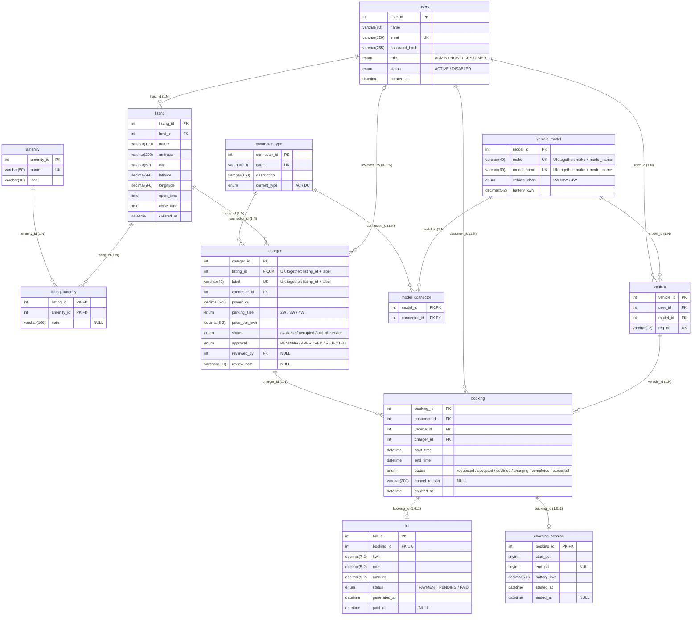
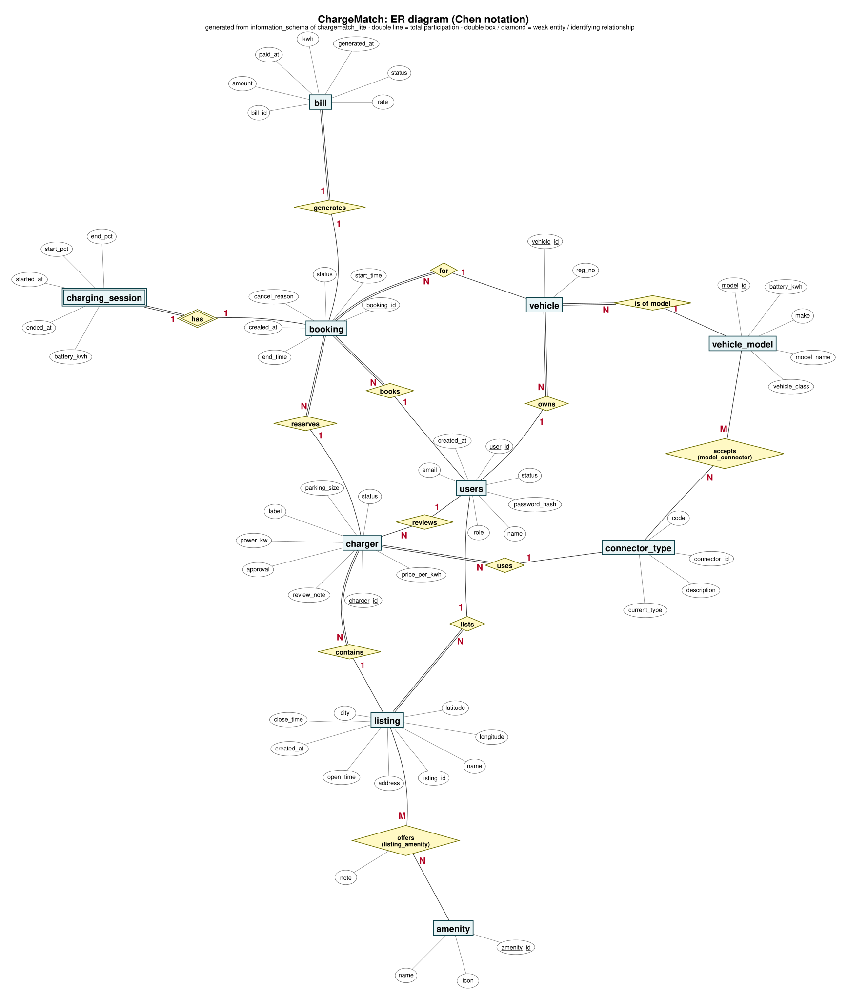

# ChargeMatch: ER diagram (generated from the live database)

Generated by `tools/er_extract.py` from `information_schema` of the live `chargematch_lite` database (read-only), then checked
against the data. Regenerate with `.venv/bin/python tools/er_extract.py` (and the render commands at the end).

* Crow's-foot (this page, also `er_crowsfoot.svg` / `er_crowsfoot.png`)
* Chen notation for the viva: `er_chen.svg` / `er_chen.png` (below)

## How each line was decided

Every line is one foreign key, written `PARENT <parent end>--<child end> CHILD : "fk_column (ratio)"`.

| Rule (from information_schema) | Symbol | Meaning |
|---|---|---|
| FK column NOT NULL | `\|\|` at the parent | each child row has **exactly one** parent |
| FK column NULL | `\|o` at the parent | each child row has **zero or one** parent |
| FK column(s) UNIQUE or the child's PK (same column set) | `o\|` at the child | each parent row has **zero or one** child (ratio 1 : 0..1) |
| otherwise | `o{` at the child | each parent row has **zero or many** children (ratio 1 : N) |

Legend: `||` exactly one · `|o` / `o|` zero or one · `o{` zero or many.

## Crow's-foot diagram





## Chen notation (for the viva)



Built by `tools/er_chen.py` from the same verified model (`er_model.json`):

* **Rectangle** = entity, **diamond** = relationship (named with a verb), **oval** = attribute, <u>underlined</u> = primary key.
  FK columns are not drawn as ovals: the relationship diamond is the foreign key.
* **1 / N / M** on each line = the same ratios as the table below (1:N, 1:0..1 drawn as 1:1, M:N).
* **Double line** = total participation: the FK is NOT NULL, so every child row takes part (e.g. every booking is made
  by a user). Single line = partial (a user need not book; `charger.reviewed_by` is NULL until reviewed).
* **Double rectangle + double diamond** = weak entity and its identifying relationship: `charging_session`'s whole
  primary key is its FK `booking_id`, so a session cannot exist or be identified without its booking.
* Junction tables are not entities: `listing_amenity` is the M:N diamond *offers* (with its attribute `note`) and
  `model_connector` is the M:N diamond *accepts*.
* Relationship names: users *lists* listing · listing *contains* charger · charger *uses* connector_type · users
  *reviews* charger · users *owns* vehicle · vehicle *is of model* vehicle_model (not "is a": ISA means inheritance in
  EER) · users *books* booking · booking *for* vehicle · booking *reserves* charger · booking *has* charging_session
  (the identifying relationship) · booking *generates* bill.

## Many-to-many relationships

* **listing M:N amenity**, resolved by `listing_amenity` (PK = listing_id + amenity_id; own attribute: note). Drawn as two 1:N lines: listing 1:N listing_amenity and amenity 1:N listing_amenity.
* **vehicle_model M:N connector_type**, resolved by `model_connector` (PK = model_id + connector_id). Drawn as two 1:N lines: vehicle_model 1:N model_connector and connector_type 1:N model_connector.

## Verification against the data

For a `o|` child end the most children any parent has must be ≤ 1; for a `||` parent end no child row may have a
NULL foreign key. The other ends need no data check (they allow more), so the actual maximum is shown for information.

| Parent | Child | FK | Nullable | Unique | Mermaid | Ratio | Data check | Verified |
|---|---|---|---|---|---|---|---|---|
| amenity | listing_amenity | amenity_id | NO | NO | `\|\|--o{` | 1:N | max children per parent = 7; child rows with NULL FK = 0 (must be 0) | ✓ |
| booking | bill | booking_id | NO | YES | `\|\|--o\|` | 1:0..1 | max children per parent = 1 (must be ≤ 1); child rows with NULL FK = 0 (must be 0) | ✓ |
| booking | charging_session | booking_id | NO | YES | `\|\|--o\|` | 1:0..1 | max children per parent = 1 (must be ≤ 1); child rows with NULL FK = 0 (must be 0) | ✓ |
| charger | booking | charger_id | NO | NO | `\|\|--o{` | 1:N | max children per parent = 4; child rows with NULL FK = 0 (must be 0) | ✓ |
| connector_type | charger | connector_id | NO | NO | `\|\|--o{` | 1:N | max children per parent = 14; child rows with NULL FK = 0 (must be 0) | ✓ |
| connector_type | model_connector | connector_id | NO | NO | `\|\|--o{` | 1:N | max children per parent = 40; child rows with NULL FK = 0 (must be 0) | ✓ |
| listing | charger | listing_id | NO | NO | `\|\|--o{` | 1:N | max children per parent = 3; child rows with NULL FK = 0 (must be 0) | ✓ |
| listing | listing_amenity | listing_id | NO | NO | `\|\|--o{` | 1:N | max children per parent = 5; child rows with NULL FK = 0 (must be 0) | ✓ |
| users | booking | customer_id | NO | NO | `\|\|--o{` | 1:N | max children per parent = 7; child rows with NULL FK = 0 (must be 0) | ✓ |
| users | charger | reviewed_by | YES | NO | `\|o--o{` | 0..1:N | max children per parent = 24; child rows with NULL FK = 2 (allowed) | ✓ |
| users | listing | host_id | NO | NO | `\|\|--o{` | 1:N | max children per parent = 3; child rows with NULL FK = 0 (must be 0) | ✓ |
| users | vehicle | user_id | NO | NO | `\|\|--o{` | 1:N | max children per parent = 2; child rows with NULL FK = 0 (must be 0) | ✓ |
| vehicle | booking | vehicle_id | NO | NO | `\|\|--o{` | 1:N | max children per parent = 6; child rows with NULL FK = 0 (must be 0) | ✓ |
| vehicle_model | model_connector | model_id | NO | NO | `\|\|--o{` | 1:N | max children per parent = 3; child rows with NULL FK = 0 (must be 0) | ✓ |
| vehicle_model | vehicle | model_id | NO | NO | `\|\|--o{` | 1:N | max children per parent = 2; child rows with NULL FK = 0 (must be 0) | ✓ |

| Count | In diagram | In information_schema | Expected | Verified |
|---|---|---|---|---|
| Foreign keys | 15 | 15 | 15 | ✓ |
| Tables | 12 | 12 | 12 | ✓ |

## Keys per table

| Table | Primary key | Unique keys |
|---|---|---|
| amenity | amenity_id | `uq_amenity_name` (name) |
| bill | bill_id | `uq_bill_booking` (booking_id) |
| booking | booking_id | — |
| charger | charger_id | `uq_charger_label` (listing_id, label) |
| charging_session | booking_id | — |
| connector_type | connector_id | `uq_connector_code` (code) |
| listing | listing_id | — |
| listing_amenity | listing_id, amenity_id | — |
| model_connector | model_id, connector_id | — |
| users | user_id | `uq_users_email` (email) |
| vehicle | vehicle_id | `uq_vehicle_reg` (reg_no) |
| vehicle_model | model_id | `uq_make_model` (make, model_name) |

## Rendering

```bash
.venv/bin/python tools/er_extract.py          # extract + verify + this page, er_crowsfoot.mmd, er_model.json
.venv/bin/python tools/er_chen.py             # er_chen.dot from er_model.json
export PUPPETEER_SKIP_DOWNLOAD=1                  # mermaid-cli uses the installed Chrome (docs/er_puppeteer.json)
npx -y @mermaid-js/mermaid-cli@11 -i docs/er_crowsfoot.mmd -o docs/er_crowsfoot.svg -b white -c docs/er_mermaid_config.json -p docs/er_puppeteer.json
npx -y @mermaid-js/mermaid-cli@11 -i docs/er_crowsfoot.mmd -o docs/er_crowsfoot.png -s 2 -b white -c docs/er_mermaid_config.json -p docs/er_puppeteer.json
dot -Tsvg docs/er_chen.dot -o docs/er_chen.svg && dot -Tpng -Gdpi=110 docs/er_chen.dot -o docs/er_chen.png   # Graphviz (brew install graphviz)
```
